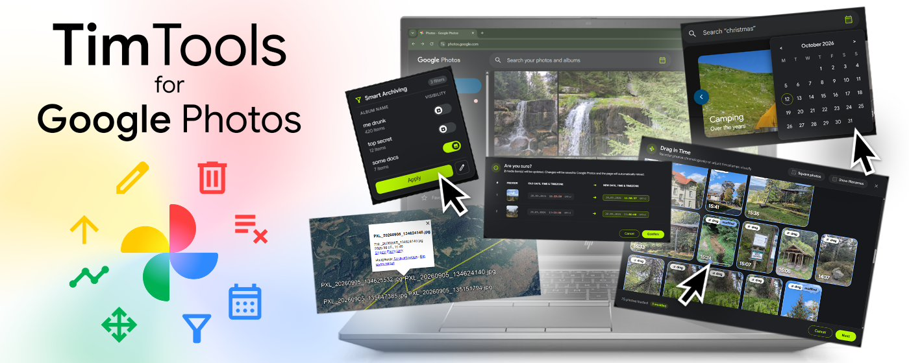
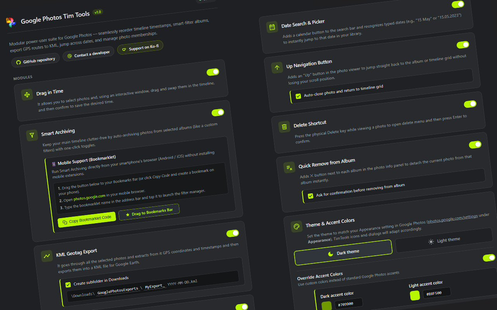
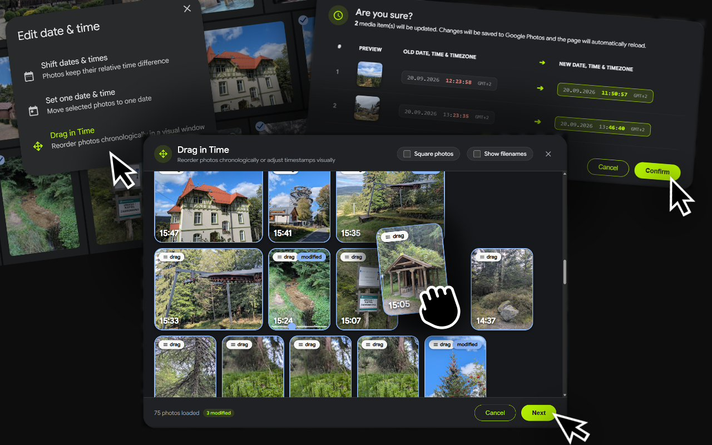
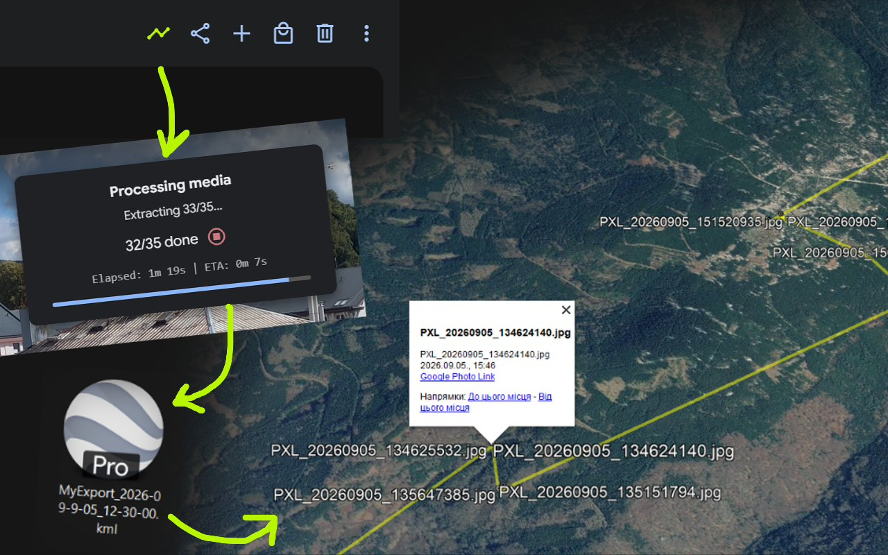
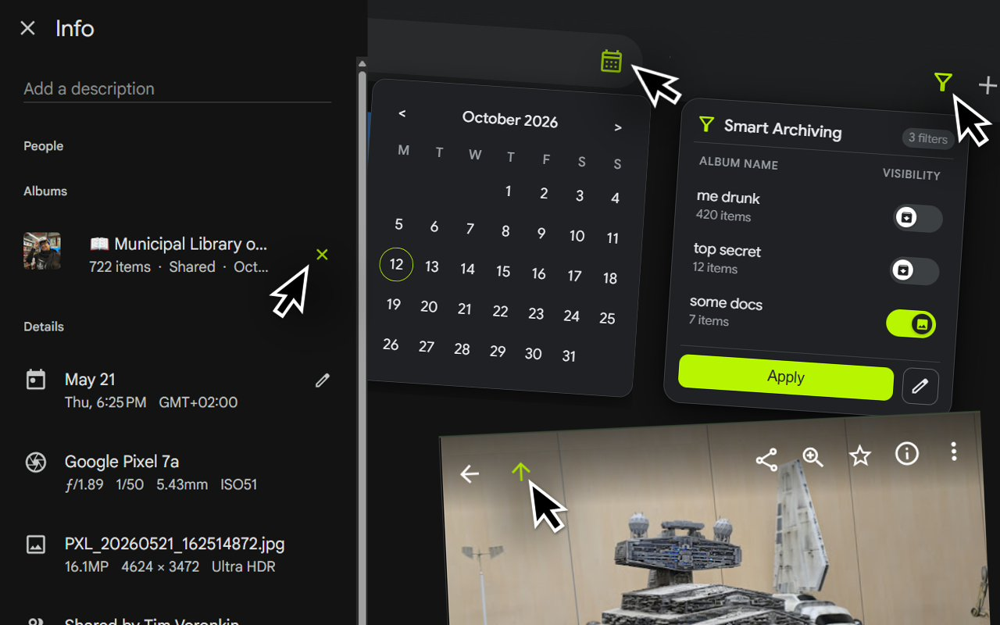

#  Google Photos Tim Tools

[](https://chromewebstore.google.com/detail/jfbkeejcoccjomdfcnihgcohfmflaojn)

A comprehensive, privacy-first Google Chrome extension that enhances [Google Photos](https://photos.google.com) with power utilities. It runs 100% locally in your browser - no third-party servers, no telemetry, and no external tracking.

<p align="center">
  
</p>

## 🧩 Modules & Features

The extension features a modular architecture where each tool can be individually enabled or configured via the Options Page. The modules are organized below in the exact order found in the extension settings:

### 1. Drag in Time

_Interactive timeline canvas for visually reordering photo timestamps._

- **Visual Drag & Drop:** Injects a "Drag in Time" action directly into Google Photos' native "Edit date & time" modal.
- **Infinite Timeline Loading:** Automatically streams and renders adjacent photos from the timeline grid so you can position pictures precisely relative to surrounding events.
- **Batch Timestamp Recalculation:** Calculates adjusted timestamps on the fly and saves them in batches using Google Photos' internal RPC (`DaSgWe`).
- **Safety Confirmations:** Shows a visual review of timestamp modifications before applying changes.

### 2. Smart Archiving

_Context-aware timeline filters to show or hide photo categories depending on who is watching._

- **Albums as Visibility Filters:** Create designated albums to act as on-demand visibility filters (e.g., _"Documents"_, _"Cringe Photos"_, _"Ex-Partner"_, or _"Receipts"_).
- **1-Click Show / Hide Toggles:** A sleek filter button in the Google Photos navigation bar opens a popover where you can toggle filter albums on or off. Photos in toggled-off albums are instantly archived to keep your primary feed clean.
- **Tailored for Social Browsing:** Showing your timeline to family, parents, or coworkers? Turn off sensitive filters to browse safely without awkward moments. Hanging out with a close friend? Restore your _"Cringe Photos"_ right back into your photostream with a single click!
- **Non-Destructive & Reversible:** Photos are simply moved between your Library and Google Photos Archive (`/archive`), never permanently deleted.
- **Set Theory Logic & Batch Sync:** If a photo belongs to multiple filter albums and at least one filter is switched Off, it remains safely archived. Syncs changes in rapid 50-photo batches via internal RPC (`w7TP3c`) with account-specific settings.
- **Mobile Bookmarklet Support:** Includes a built-in bookmarklet generator to run your archiving filters on mobile browsers (Android and iOS).

### 3. KML Geotag Export

_Extract GPS coordinates, timestamps, and photo routes into KML for Google Earth._

- **Automated Metadata Scraper:** Traverses selected photos using a headless master/child tab background flow that circumvents CORS limitations.
- **Chronological Route Generation:** Generates a continuous `LineString` GPS track and individual waypoint `Placemarks` with direct links back to each photo.
- **Configurable Destination:** Choose whether to save into a dedicated subfolder in your Downloads directory and specify custom filename prefixes and date patterns (e.g., `MyExport_YYYY-MM-DD.kml`).

### 4. Date Search & Picker

_Instant date navigation and natural language search parsing._

- **Search Bar Calendar Button:** Adds a date picker icon inside the Google Photos search bar.
- **Interactive Calendar:** Pick any day, month, or year from a custom Material-styled calendar dropdown to jump directly to that date in your timeline.
- **Natural Language Parsing:** Automatically understands typed dates in English, Ukrainian, and Russian (e.g., _"15 May"_, _"15 травня"_, _"2023.08.12"_) and formats them into Google Photos' search syntax.

### 5. Up Navigation Button

_Escape albums and searches back to the main timeline without losing your place._

- **Context Escaper:** Injects an "Up" button into the photo viewer header when browsing inside an album, search query, or shared link.
- **URL Parameter Stripping:** Removes contextual tracking queries from the URL and opens the identical photo in the primary photostream timeline.
- **Optional Auto-Close:** Configure whether clicking "Up" automatically closes the single photo view to land directly on the grid.

### 6. Delete Shortcut

_Native physical keyboard shortcut to delete photos quickly._

- **Physical `Delete` Key Binding:** Press `Delete` while viewing any photo to instantly trigger the native Google Photos delete action.
- **Keyboard Confirmation:** Press `Enter` to confirm the deletion modal or `Escape` to dismiss.
- **Input Guard:** Smartly ignores keystrokes whenever typing inside text fields, search bars, or description editors.

### 7. Quick Remove from Album (AlbumQuickRemove)

_One-click detachment of photos from albums inside the Info sidebar._

- **Direct Remove Button:** Adds a dedicated `✕` button beside each album listed in the photo's Info panel (`i`).
- **Precise Membership Resolution:** Queries internal album item tokens (`snAcKc`) to locate the specific photo-album membership before executing the removal RPC (`ycV3Nd`).
- **Optional Confirmation Dialog:** Toggleable safety modal with keyboard support (`Enter` to confirm, `Esc` to cancel) so you never remove a photo by accident.

## 🎨 Customization & Settings

Access the extension options page at any time by clicking the extension icon in your Chrome toolbar or navigating to `chrome://extensions/` -> **Google Photos Tim Tools** -> **Options**.

### Theme & Accent Colors

- **Appearance Sync:** Choose between **Dark theme** and **Light theme** to mirror your preferred appearance at `photos.google.com/settings`.
- **Override Accent Colors:** Enable custom accent colors to replace default Google Photos blues with your personal color palette using real-time color pickers and hex inputs.
- **Organic UI Integration:** All custom extension buttons, icons, modals, and tooltips seamlessly adopt the selected accent color.

### Debug Logging

- **Unified Diagnostic Output:** Toggle detailed console logs formatted as `[GP-TimTools][ModuleName]` to troubleshoot extension behavior or monitor RPC network cycles. Completely silent when disabled.

## 📸 Screenshots

| | |
|:---:|:---:|
|  |  |
|  |  |

## 🛠️ Installation & Setup

### 🌟 Chrome Web Store (Recommended)

Install directly from the official Chrome Web Store for one-click setup and automatic updates:
👉 [https://ChromeWebStore.Google.com/detail/jfbkeejcoccjomdfcnihgcohfmflaojn](https://chromewebstore.google.com/detail/jfbkeejcoccjomdfcnihgcohfmflaojn)

---

### 💻 Manual Installation (Developer / Unpacked Mode)

If you wish to test or run the extension directly from source:

1. **Clone or Download:**
   ```bash
   git clone https://github.com/TimVoronkin/GooglePhotos-TimTools.git
   ```
   *(Or download the ZIP archive and extract it).*
2. **Open Extensions Page:**
   Navigate to `chrome://extensions/` in Google Chrome (or any Chromium browser like Brave, Edge, Vivaldi, Opera).
3. **Enable Developer Mode:**
   Toggle **Developer mode** in the top-right corner.
4. **Load Extension:**
   Click **Load unpacked** and select the root repository folder containing `manifest.json`.
5. **Open Google Photos:**
   Navigate to [photos.google.com](https://photos.google.com) to start using the tools!

## 📦 Building for Chrome Web Store

To generate a clean production-ready `.zip` archive for uploading to the [Chrome Web Store Developer Dashboard](https://chrome.google.com/webstore/devconsole):

- **PowerShell (Windows):**
  ```powershell
  .\build.ps1
  ```
- **Node.js / npm (Cross-platform):**
  ```bash
  npm run build
  ```

**What the build script does automatically:**
- Collects only runtime extension code (`src/`, `manifest.json`, optimized icons).
- Excludes heavy source files (`.psd` assets, raw promo mockups, git history, docs).
- Strips the local development `"key"` field from `manifest.json` as required by the Chrome Web Store.
- Generates a lightweight (~125 KB) `dist/GooglePhotos-TimTools-v<version>.zip` ready for instant publishing.

## 🔒 Privacy & Security

- **Local Execution:** All script operations run strictly inside your browser session.
- **No Remote Tracking:** No third-party analytics, metrics, external APIs, or remote servers.
- **Standard Permissions:** Uses only standard Chrome APIs (`storage` for settings, `downloads` for KML files, `clipboardWrite` for bookmarklet export, and `tabs` for KML multi-tab scraping).

## 💖 Support the Developer

If Google Photos Tim Tools saves you time and enhances your photo library workflow, consider supporting ongoing development:

- ☕ **Buy me a coffee:** [Ko-fi.com/Tim_Voronkin](https://ko-fi.com/tim_voronkin)
- ⭐ **Rate & Write a Review:** [ChromeWebStore.Google.com/detail/jfbkeejcoccjomdfcnihgcohfmflaojn](https://chromewebstore.google.com/detail/jfbkeejcoccjomdfcnihgcohfmflaojn/reviews)
- 🌟 **Star the repository:** [GitHub.com/TimVoronkin/GooglePhotos-TimTools](https://github.com/TimVoronkin/GooglePhotos-TimTools)
- 🌐 **Contact the developer:** [TimVoronkin.github.io](https://timvoronkin.github.io/)
